# NUMVERSE : ta calculatrice devient un monde en 3D

**NUMVERSE remplace l'écran d'accueil de la calculatrice NumWorks (n0110, n0115 ou n0120) par
un monde en 3D à la première personne.** Il n'y a plus de menu : tu marches.
Chaque appli de la calculatrice est un portail qui tourbillonne, tes jeux
`.nwa` sont des bornes d'arcade, et **BIP**, l'âme de ta calculatrice,
commente tout ce que tu fais. Dix pièces π sont cachées, une salle secrète
attend derrière une porte, et un fantôme, **le Glitch**, rôde dans le
labyrinthe.

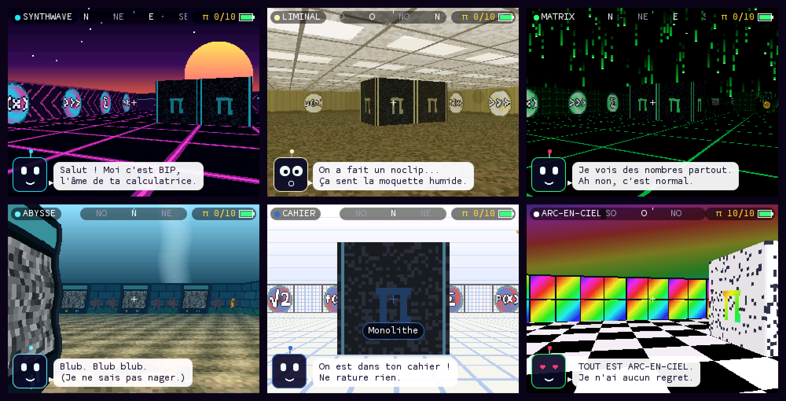

<p align="center">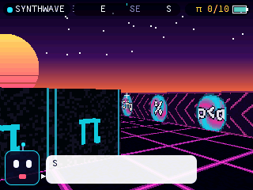</p>

> Les captures viennent du simulateur, qui ne sait pas charger de jeux : les
> bornes d'arcade y affichent de la neige. Sur la calculatrice, chaque borne
> affiche l'icône de son jeu sur son écran.

## Ce que fait NUMVERSE

- **Un vrai moteur 3D** écrit pour la calculatrice : un *raycaster* qui
  lance 320 rayons par image, avec murs, sol et plafond texturés, brouillard,
  ciel animé et objets en 3D (pièces, fantôme). Toutes les textures sont
  générées par le code : aucune image n'est stockée. Si la calculatrice ne
  suit pas, NUMVERSE passe tout seul en demi-résolution horizontale.
- **Les applis sont des portails** : un tourbillon animé avec le symbole de
  l'appli (`f(x)`, `x=?`, `Σ`, `>>>`…). Regarde-en un et appuie sur **OK** :
  saut dimensionnel, et l'appli s'ouvre.
- **Les jeux sont des bornes d'arcade** dans la salle d'arcade : l'icône du
  jeu s'affiche sur l'écran de la borne, avec des lignes de balayage.
- **BIP**, un petit robot en bas à gauche, parle dans une bulle : il te
  présente le monde au premier démarrage, commente chaque portail, râle quand
  tu fonces dans un mur, s'ennuie si tu ne bouges plus, s'endort (et la
  calculatrice ralentit pour économiser la batterie), a peur du Glitch,
  porte des lunettes de soleil en Synthwave et raconte des blagues de maths
  (touche **Ans**).
- **Six réalités**, à changer à tout moment avec les touches **1 à 5** :

  | Touche | Réalité | Ambiance |
  | --- | --- | --- |
  | 1 | **Synthwave** | soleil rayé, grille néon, étoiles |
  | 2 | **Liminal** | couloirs jaunes, moquette, néons qui grésillent |
  | 3 | **Matrix** | pluie de code verte sur les murs et dans le ciel |
  | 4 | **Abysse** | sous l'eau : rayons de lumière, bulles, image qui ondule |
  | 5 | **Cahier** | tout est dessiné sur une feuille Seyès, soleil au crayon |
  | 6 | **Arc-en-ciel** | à débloquer… |

- **La chasse aux π** : 10 pièces π tournent dans le monde. Les 10 ouvrent la
  porte secrète du labyrinthe ; derrière, un trophée, un générique de fin et
  la sixième réalité.
- **Le Glitch** : un fantôme qui change de couleur et se découpe en tranches.
  Il erre dans le labyrinthe et te poursuit quand tu t'approches. S'il te
  touche : *RÉALITÉ CORROMPUE*, et retour au hall.
- **Le téléporteur** (touche **Retour**) : tous les lieux, toutes les applis
  et tous les jeux dans une liste, pour aller vite.
- **La carte** (touche **boîte à outils**) : seules les zones déjà explorées
  apparaissent, avec les pièces que tu as vues et le Glitch.
- **Démarrage façon BIOS** : écran cathodique qui s'allume, test du matériel
  (« Ennui de l'utilisateur : ÉLEVÉ », « Chargement de reality.dll :
  ÉCHEC »), puis le logo.
- **Et aussi** : saut (**EXE**), TURBO quand tu maintiens ▲, boussole,
  balancement de la tête en marchant, chute du ciel à l'arrivée, fête du π
  avec confettis (touche **π**), mode photo sans interface (**Var**).
- **Barre de titre magenta néon** dans les applis, au lieu du jaune NumWorks.
- **Installateurs en un clic pour Mac et pour Windows** : une page web
  locale qui détecte la calculatrice, gère tes jeux (glisser-déposer) et
  installe tout avec un bouton. Sur Windows, un simple `.exe` : rien à
  installer, ni Python ni pilote.

<p align="center"></p>

## Les commandes

| Touche | Action |
| --- | --- |
| ▲ ▼ | avancer, reculer (maintiens ▲ : TURBO) |
| ◀ ▶ | tourner |
| OK | entrer dans le portail ou la borne que tu regardes |
| EXE | sauter |
| Retour | le téléporteur |
| Boîte à outils | la carte |
| 1 à 5 (et 6) | changer de réalité |
| Ans | une blague de BIP |
| π | la fête du π |
| Var | mode photo |

## Captures

| | |
| --- | --- |
| 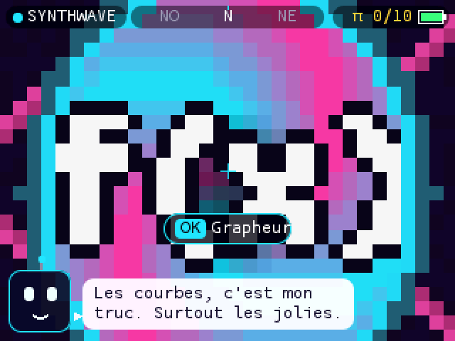 | 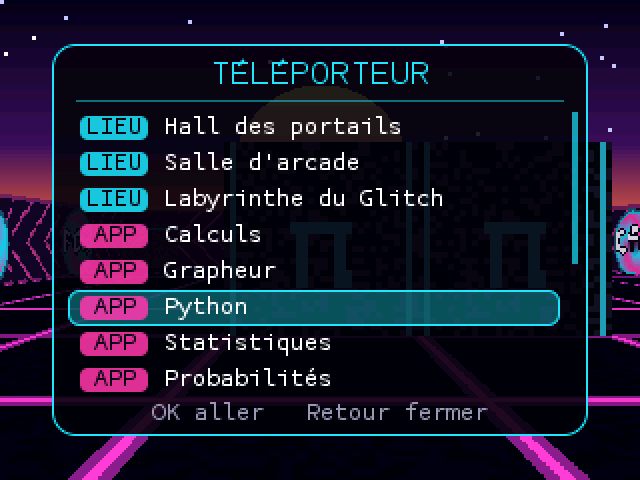 |
| Un portail : OK pour y entrer | Le téléporteur |
| 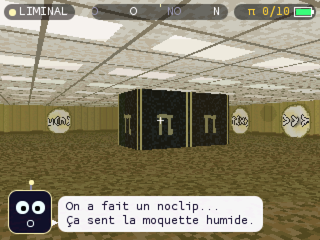 | 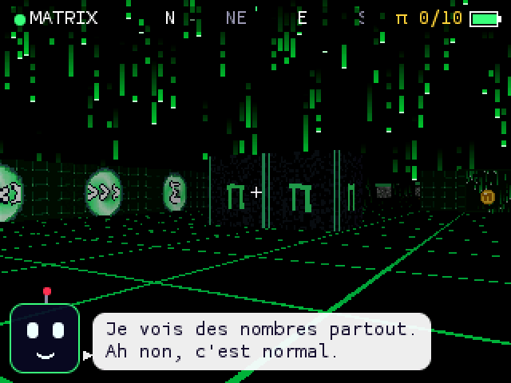 |
| Réalité Liminal | Réalité Matrix |
| 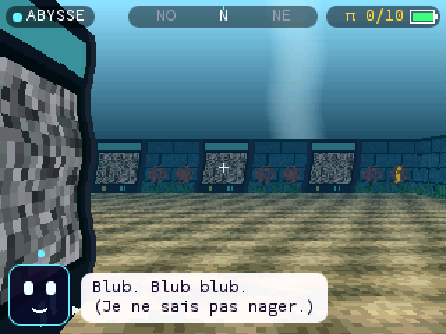 | 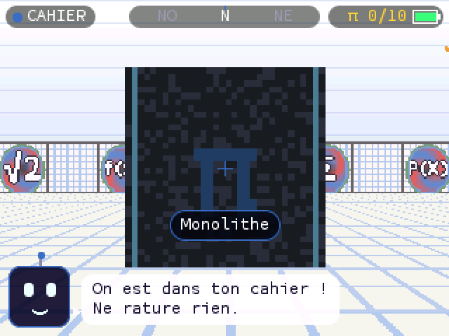 |
| Réalité Abysse | Réalité Cahier |
| 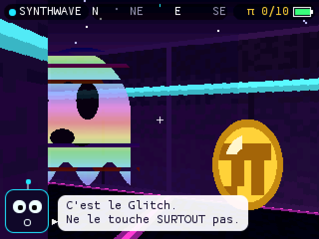 | 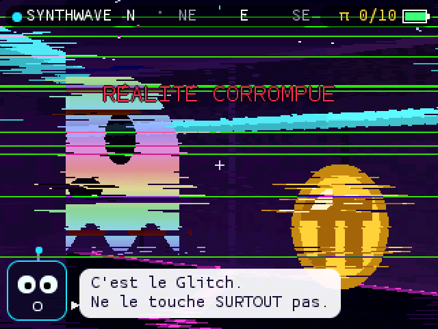 |
| Le Glitch et une pièce π | Quand le Glitch te touche |
| 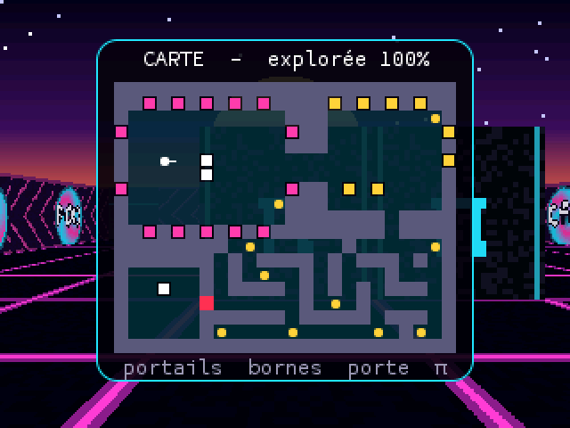 | 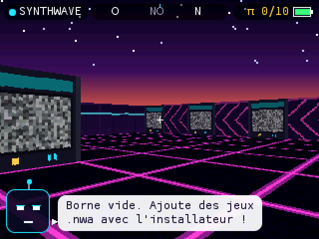 |
| La carte | La salle d'arcade |
| 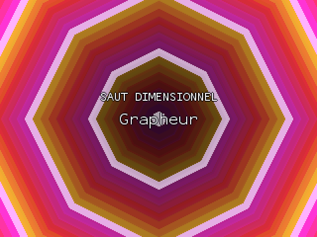 | 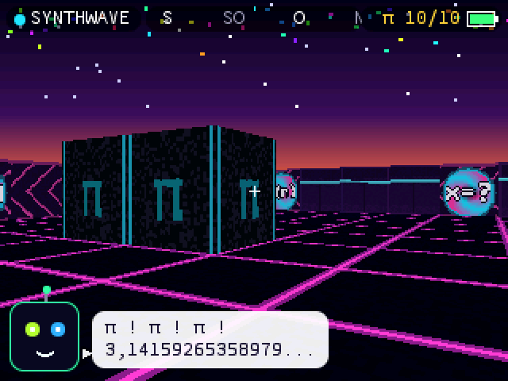 |
| Le saut vers une appli | La fête du π |
| 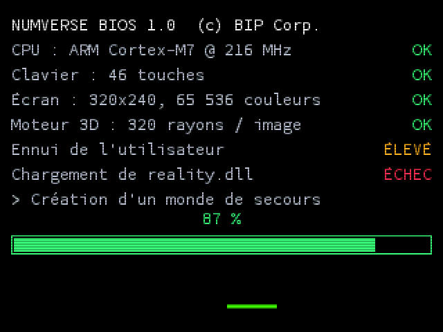 | 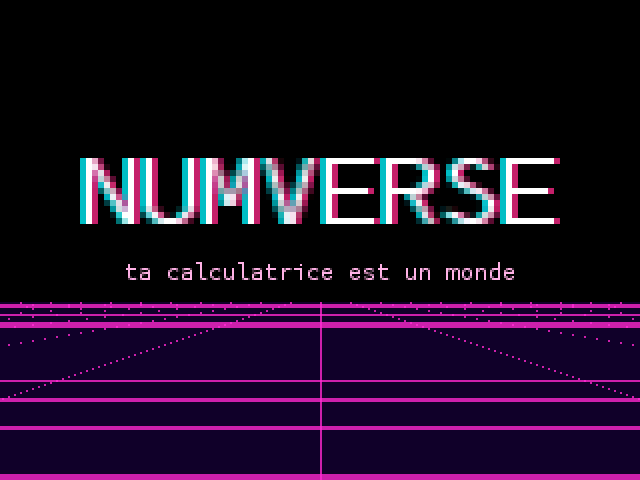 |
| Le démarrage | Le logo |

*(La salle secrète et le générique sont dans `docs/`, mais ce serait
dommage de te gâcher la surprise.)*

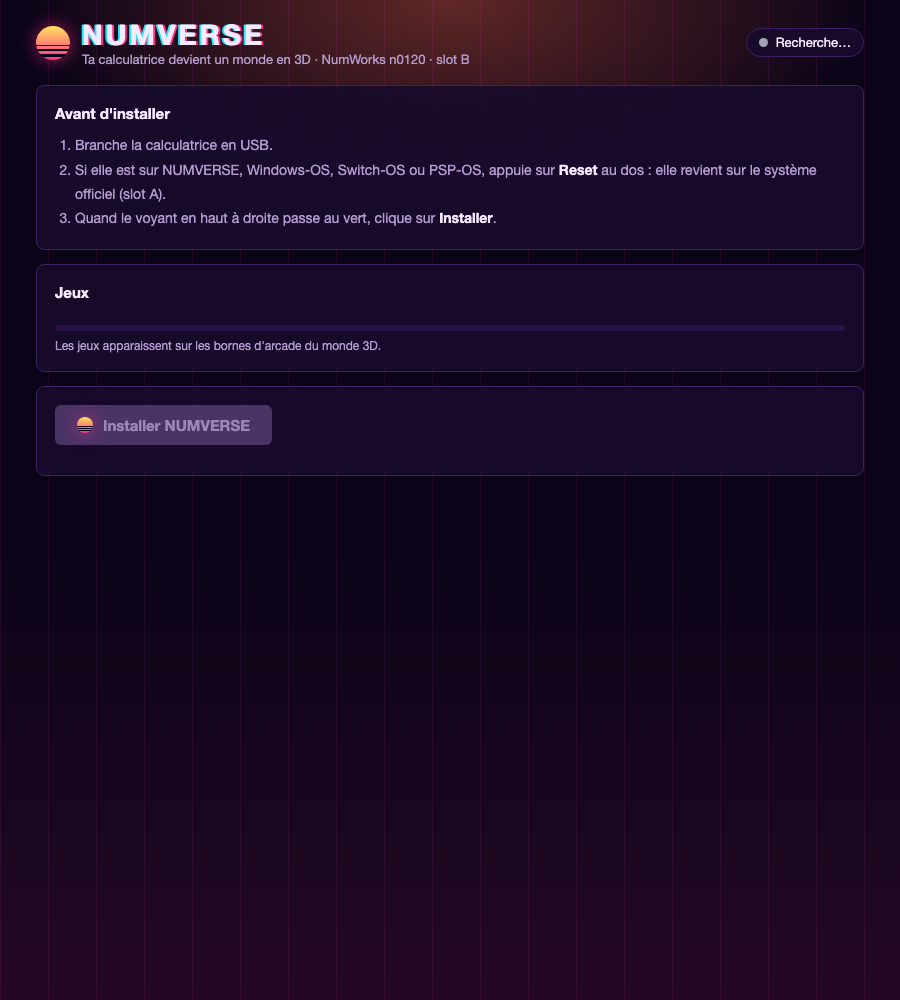

## Installation

### 1. Obtenir NUMVERSE

Depuis juillet 2021, le code d'Epsilon (le logiciel de la NumWorks) n'est plus
sous licence libre. NUMVERSE ne publie donc **aucun code ni aucun firmware de
NumWorks** : seulement un **patch** (`patches/numverse-epsilon.patch`) et son
propre code. Le firmware se compile à partir des sources officielles de
NumWorks, dans ton compte GitHub ou sur ton Mac.

**Sans rien compiler (Mac ou Windows)**

1. En haut de cette page : **Use this template** > **Create a new repository**,
   coche **Private** (obligatoire : la compilation refuse de tourner dans un
   dépôt public, pour que le firmware ne soit pas téléchargeable par tous).
2. Facultatif : ajoute tes jeux `.nwa` dans le dossier `games/` de ta copie
   privée (*Add file* > *Upload files*). Ils seront préparés et inclus dans
   l'installateur, et apparaîtront sur les bornes d'arcade.
3. Dans ta copie : onglet **Actions** > **Build NUMVERSE** > **Run workflow**.
4. Environ 30 minutes plus tard (un firmware par modèle), en bas de la page de la compilation,
   télécharge **NUMVERSE-Mac** ou **NUMVERSE-Windows** et décompresse-le
   (deux fois pour la version Mac : GitHub met le zip dans un zip).

**En compilant sur ton Mac**

```bash
brew install make dfu-util libusb
brew install --cask gcc-arm-embedded
git clone https://github.com/derim00/numverse.git && cd numverse
./scripts/build-firmware.sh
```

Le script télécharge Epsilon au commit indiqué dans `EPSILON_COMMIT`
(Epsilon 26.1, la dernière version publiée par NumWorks), applique le patch,
compile, prépare les jeux de `games/` et remplit le dossier `installer/`.

### 2. Installer sur la calculatrice

**Sur Mac**

1. Une seule fois : `brew install libusb dfu-util` (et
   `brew install --cask gcc-arm-embedded` pour ajouter d'autres jeux).
2. Double-clique sur **`Installer NUMVERSE.command`** (la première fois :
   clic droit > **Ouvrir**). La page de l'installateur s'ouvre
   (http://127.0.0.1:8768).

**Sur Windows** (rien à installer : ni Python, ni pilote)

1. Décompresse **NUMVERSE-Windows** (clic droit > *Extraire tout*) : ne
   lance pas l'installateur depuis l'intérieur du zip.
2. Dans le dossier `NUMVERSE`, double-clique sur **`Installer NUMVERSE.exe`**
   (si SmartScreen s'affiche : *Informations complémentaires* > *Exécuter
   quand même*). Une fenêtre noire s'ouvre avec la page de l'installateur dans
   ton navigateur : laisse-la ouverte, et ferme-la à la fin pour quitter.

**Ensuite, sur les deux**

3. Branche la calculatrice en USB et appuie sur **Reset** au dos : elle
   redémarre sur le système officiel.
4. Quand le voyant passe au vert, glisse tes jeux `.nwa` dans la page si tu
   veux, puis clique sur **Installer NUMVERSE**.

L'installateur vérifie que le **slot B** est libre avant d'écrire : le système
officiel (slot A) n'est jamais modifié. Il prépare les jeux pour leur place
dans le slot B (comme le fait le site de NumWorks), les copie, les relit pour
les vérifier, puis installe NUMVERSE et le démarre.

## À savoir

- **Calculatrice** : NumWorks **n0110**, **n0115** ou **n0120**, avec le logiciel officiel
  **26.4.0** dans le slot A. NUMVERSE est compilé à partir d'Epsilon 26.1 (la
  dernière version publiée) avec le numéro de version 26.4.0.
- **Trois modèles** : la compilation produit un firmware par modèle
  (n0110, n0115, n0120) et l'installateur choisit tout seul celui de la
  calculatrice branchée. Mets d'abord ta calculatrice à jour sur
  numworks.com : le système doit avoir la même version que le logiciel
  officiel du slot A.
- **Jeux trop gros** : un jeu qui ne tient pas dans le slot B (NumPlay,
  par exemple) est ignoré avec un message, au lieu de faire échouer la
  compilation. Retire-le du dossier `games/`.
- **Mémoire** : le moteur 3D (textures, tampons) vit dans la mémoire de
  l'appli d'accueil, qui est libre tant que le monde est affiché : NUMVERSE
  utilise moins de RAM que Windows-OS. Ta progression (position, pièces,
  réalité) reste en mémoire quand tu ouvres une appli ; elle repart de zéro
  après un Reset.
- **Batterie** : le monde est redessiné en continu quand tu bouges ; quand
  BIP s'endort (40 secondes sans toucher à rien), NUMVERSE ralentit.
- **Après un Reset**, la calculatrice revient sur le système officiel :
  NUMVERSE reste dans le slot B, il suffit de relancer l'installation.
- **Un seul système dans le slot B** : NUMVERSE remplace
  [PSP-OS](https://github.com/derim00/psp-os),
  [Switch-OS](https://github.com/derim00/switch-os) ou
  [Windows-OS](https://github.com/derim00/windows-os) s'il était installé,
  et inversement. Les installateurs peuvent tourner en même temps (ports 8765
  à 8768).
- **Touches Home et On/Off** : sur un logiciel non officiel, le système de la
  calculatrice gère lui-même ces deux touches. NUMVERSE efface au démarrage le
  point de retour laissé par le système officiel pour que Home ramène au
  monde ; si la calculatrice revient quand même sur le slot A, utilise
  **Retour** (↩) pour revenir au monde depuis une appli.
- **Mode examen** : NUMVERSE garde les règles du mode examen d'Epsilon
  (applis interdites, jeux bloqués).
- **Jeux** : seulement des applis `.nwa` dont tu as le droit de te servir, et
  uniquement dans ta copie privée : jamais dans ce dépôt public.

## Comment c'est fait

| Fichier | Rôle |
| --- | --- |
| `patches/numverse-epsilon.patch` | le monde 3D (`apps/home/verse`), l'animation continue (`escher`), la barre magenta, le correctif Home / On-Off |
| `apps/home/verse/engine.cpp` (dans le patch) | le moteur : lancer de rayons, sol et plafond, ciel, sprites, textures générées pour chaque réalité |
| `apps/home/verse/shell.cpp` (dans le patch) | le monde : déplacements, BIP, pièces π, Glitch, téléporteur, carte, démarrage, générique |
| `apps/home/verse/gfx.cpp` (dans le patch) | le dessin par bandes de 12 lignes, le texte, les icônes des jeux |
| `scripts/build-firmware.sh` | télécharge Epsilon, applique le patch, compile, prépare l'installateur |
| `installer/server.py` | serveur local (127.0.0.1 uniquement) de l'installateur, Mac et Windows |
| `installer/dfu_launch.py` | lance l'outil DFU de NumWorks avec libusb (Homebrew ou `libusb-package`) |
| `scripts/build-windows-installer.py` | fait `Installer NUMVERSE.exe` avec PyInstaller (sur Windows, dans le workflow) et le teste |
| `installer/index.html` | la page de l'installateur |
| `installer/link_games.py` | place chaque jeu `.nwa` à son adresse dans le slot B, comme le site de NumWorks |
| `installer/Installer NUMVERSE.command` | lanceur en double-clic pour Mac |
| `.github/workflows/build.yml` | compilation dans ta copie privée, avec les deux installateurs |

Le simulateur sait faire une séance photo : compilé pour macOS, lancé avec
`NUMVERSE_SHOTS=<dossier>`, il enregistre les images de ce README (ce code
n'existe pas dans le firmware de la calculatrice).

## Licence

Le code de NUMVERSE est sous licence **CC BY-NC-SA 4.0** (voir `LICENSE`).
Epsilon reste la propriété de NumWorks et n'est pas inclus dans ce dépôt.
NUMVERSE est un projet de fan, sans lien avec NumWorks.
